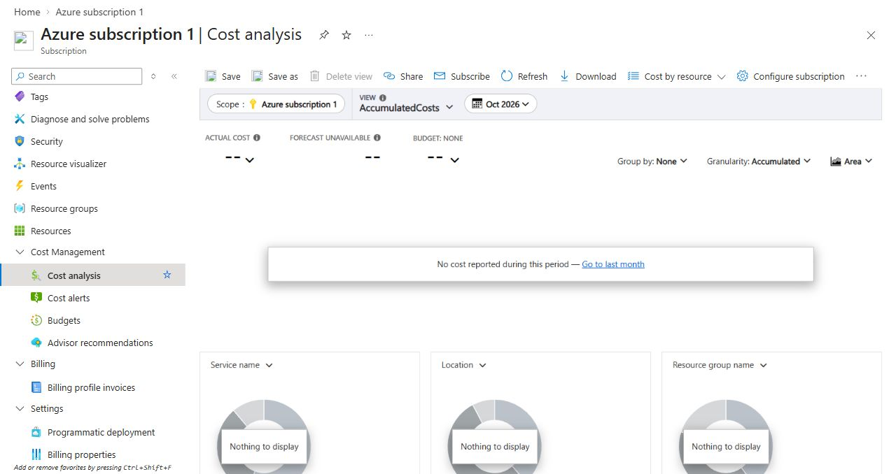

# Cost model and boundaries

## Verified before deployment

The portal showed an active trial subscription, $200 remaining sign-up credit, 0% used, effective 29 September 2026 and expiring 29 October 2026. The baseline subscription cost and forecast were zero. The initial billing profile showed no amount due. These are observations at the recorded time, not a guarantee of future billing.

Microsoft Sentinel displayed its own trial from 10 October through 10 November 2026 at 23:59:59 UTC, covering up to 10 GB/day of qualifying ingestion/analysis. **The earlier Azure credit expiration controls the lab schedule.** The Sentinel offer does not authorize continued use after the Azure trial ends.

## Regional pricing checked

An unauthenticated Azure Retail Prices API query for North Europe returned a Sentinel Pay-as-you-go Analysis price of **USD 5.16/GB** on 10 October 2026. At 10 MB, that is approximately USD 0.052 before trial benefits. This is a retail estimate, not an account quote or an invoice. The simplified Sentinel price must not be added to a separate Log Analytics ingestion price for the same data.

AzureActivity is a free Sentinel data source under the documented billing rules. The executed query found 7 rows / 56,417 bytes / 0 billable rows in the lab group at approximately 14:53 Europe/Oslo on 11 October. `_BilledSize` measures the row size even when `_IsBillable` is false. This measurement does not cover every table or resource and is not total subscription spend.

## Controls applied

Budget: `atlas-trial-labs-oct2026`, NOK 20/month, October 2026, ending 30 October. Actual alert 25% (NOK 5), forecast alert 50% (NOK 10), delivered to the account owner. No action group or automatic remediation was created.

Workspace cap: 0.100 GB/day, reset shown as 22:00 UTC. Its purpose is to limit ingestion exposure; Microsoft documents that a daily cap can overshoot. Free data may also be treated differently by the cap. It is not a substitute for the trial spending protection.

No compute, data lake, extended retention, Logic Apps, Functions, third-party ingestion or paid Defender plan was added. No support, Marketplace or Entra Premium purchase was made. Existing trial/retention benefits must be rechecked for a future reproduction.

## Closing observation — 11 October, approximately 20:41 Europe/Oslo

Subscription Cost Analysis for October displayed **No cost reported during this period**, Actual cost `--`, and Forecast unavailable. This is not a finalized zero-cost invoice. A contemporaneous portal notification displayed NOK 1,904.17 remaining credit; no currency conversion or consumed-dollar amount is inferred from it. Billing can arrive later. No subscription upgrade or spending-protection change was performed.

The chart's Budget: None is its selected comparison, not evidence that the separately created budget was deleted.

## References

- [Azure Free Trial offer and exclusions](https://azure.microsoft.com/en-us/pricing/offers/ms-azr-0044p/)
- [Azure spending limit](https://learn.microsoft.com/en-us/azure/cost-management-billing/manage/spending-limit)
- [Sentinel billing and free data sources](https://learn.microsoft.com/en-us/azure/sentinel/billing)
- [Log Analytics daily cap](https://learn.microsoft.com/en-us/azure/azure-monitor/logs/daily-cap)
- [Azure Retail Prices API](https://learn.microsoft.com/en-us/rest/api/cost-management/retail-prices/azure-retail-prices)

